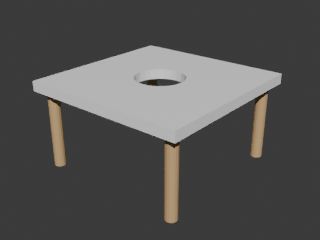

# dsh-blender-studio

> 让 DeepSeek Harness（DSH）里的 agent 直接**建模**：在 Blender 里建几何体、改网格、加修改器、做布尔、配材质、出渲染图、导出模型。

[English README](README.en.md) · [更新日志](CHANGELOG.md)



上图是端到端测试里由 agent 命令生成并渲染的桌子：桌面（cube + 布尔开孔 + 倒角）+ 四条腿（cylinder + join），全部通过本插件的 `blender_*` 工具完成。

---

## 目录

- [它能做什么](#它能做什么)
- [30 秒安装](#30-秒安装)
- [让 Blender 端上线](#让-blender-端上线)
- [验证连通](#验证连通)
- [工具清单](#工具清单)
- [典型工作流](#典型工作流)
- [配置](#配置)
- [架构与线程模型](#架构与线程模型)
- [安全](#安全)
- [故障排查](#故障排查)
- [开发与测试](#开发与测试)
- [卸载](#卸载)
- [目录结构](#目录结构)

---

## 它能做什么

在 DSH 里说一句「用 Blender 建一张桌子，四条腿，木色，渲染给我看看」，agent 会：

1. `blender_status` 确认 Blender 连接与场景状态；
2. `blender_create_primitive` 建桌面与桌腿，`blender_mesh_edit` / `blender_modifier` / `blender_boolean` 加工形状；
3. `blender_material` 上木色材质，`blender_render_view` 渲染预览（可直接用 `read_image` 看图）；
4. `blender_export` 导出 GLB / FBX / OBJ / STL / USD / blend。

整套东西没有云端依赖、没有 npm 依赖、没有 Python 依赖：DSH 侧是一个纯 JavaScript 插件，Blender 侧是一个只用标准库的 add-on。

---

## 30 秒安装

### 前置条件

| 需要 | 说明 |
| --- | --- |
| DSH 桌面端 / dsh | 任意近期版本，插件通过 `cordis.patch.yml` 加载 |
| Blender | 3.6 及以上（已在 **Blender 5.2.2 LTS** 上做过端到端验证） |
| Node.js | ≥ 18（只在跑测试或 `dsh plugin add` 时需要） |

### 方式 A：一条命令（推荐）

```bash
git clone https://github.com/<你的用户名>/dsh-blender-studio.git
cd dsh-blender-studio

# Windows（PowerShell）
./install.ps1

# macOS / Linux
./install.sh
```

脚本做三件事，全部可重复执行、可逆：

1. 把仓库以**目录联接/软链接**的方式挂进 `<Profile>/node_modules/dsh-blender-studio`（所以之后 `git pull` 就等于升级插件）；
2. 在 `<Profile>/cordis.patch.yml` 里写入一个带标记的托管块（改前自动备份）；
3. 把 Blender 侧 add-on 复制进 Blender 的用户插件目录（可加 `-SkipAddon` / `SKIP_ADDON=1` 跳过）。

### 方式 B：DSH 插件安装器

```bash
dsh plugin add github:<你的用户名>/dsh-blender-studio
```

包内自带 `cordis.patch.yml`，安装器会按 `dsh.bundle.patch` 自动接线，不需要手改配置。

### 方式 C：手动

1. 把本仓库放到 `<Profile>/node_modules/dsh-blender-studio`（复制或建链接均可）；
2. 在 `<Profile>/cordis.patch.yml` 追加：

```yaml
- insert:
    - id: blender-studio
      name: dsh-blender-studio
      config:
        enabled: true
        host: 127.0.0.1
        port: 9880
```

3. 重启 DSH。

---

## 让 Blender 端上线

DSH 侧插件只负责「发指令」，真正动手的是 Blender 里的 **DSH Blender Bridge** add-on。三种装法任选：

**① 用仓库里的脚本**（安装脚本已自动执行过）：

```powershell
./addon/install-addon.ps1            # Windows
```

```bash
./addon/install-addon.sh             # macOS / Linux
```

**② 从 zip 安装**（Blender 4.2+ 的 Extensions 面板或老版本的 Add-ons 面板）：

```bash
npm run pack:addon    # 生成 dist/dsh_blender_bridge-0.1.0.zip
```

然后在 Blender 里 `Edit > Preferences > Add-ons > Install from Disk…`（4.2+ 是 `Extensions > Install from Disk…`）选择该 zip。

**③ 让 DSH 自己装**：在对话里调用

```
blender_configure action=install_addon
```

装好之后：`Edit > Preferences > Add-ons` 搜索 “DSH Blender Bridge” 并勾选。启用即自动监听 `127.0.0.1:9880`，3D 视图右侧（N 面板）会出现 **DSH** 标签页，显示运行状态与端口。

> 无界面环境（服务器 / CI）可以不走 GUI：
> `blender --background --python addon/dsh_blender_bridge/dsh_headless.py -- --port 9880`

---

## 验证连通

在 DSH 里说一句：

```
blender_status
```

正常会返回 Blender 版本、当前 .blend、渲染引擎、单位、3D 光标、对象计数；连不上时它会明确告诉你卡在哪一步（Blender 没开 / 插件没启用 / 端口不一致）。

连不上时的万能命令：

```
blender_configure action=doctor
```

---

## 工具清单

| 工具 | 作用 |
| --- | --- |
| `blender_status` | 连接状态 + 场景概览（可选列出全部对象） |
| `blender_list_objects` | 列对象：类型、位置、尺寸、拓扑数、材质、修改器 |
| `blender_create_primitive` | 建 cube / sphere / ico_sphere / cylinder / cone / torus / plane / grid / circle / monkey / empty / camera / light |
| `blender_select_objects` | 选择集（替换/追加/减去/切换）、设置活动对象 |
| `blender_transform_object` | 移动 / 旋转 / 缩放，支持增量与 apply |
| `blender_duplicate_objects` | 复制与线性、缩放阵列 |
| `blender_object_ops` | join / separate / 设置原点 / 平滑着色 / 改名 / apply 变换 / 移动集合 / 父子关系 |
| `blender_delete_objects` | 按名删除或清场（可保留相机与灯） |
| `blender_mesh_edit` | 编辑模式：挤出 / 内插 / 倒角 / 细分 / 加厚 / 合并点 / 翻转法线 / 删面 / 平滑顶点 / 反细分 / 三角化 |
| `blender_modifier` | 添加 / 应用 / 删除 / 列出修改器（SUBSURF、BEVEL、MIRROR、SOLIDIFY、ARRAY、BOOLEAN…） |
| `blender_boolean` | 布尔差集 / 并集 / 交集，可选保留或删除 cutter |
| `blender_material` | 建 / 指派 / 改 / 列材质（颜色、金属度、粗糙度、自发光、透明、透射） |
| `blender_render_view` | 相机渲染预览 PNG（自动补光、自动取景），返回可 `read_image` 的文件路径 |
| `blender_screenshot` | 截 3D 视口 / 整个窗口（仅 GUI 会话） |
| `blender_export` | 导出 glb / gltf / fbx / obj / stl / ply / usd / blend |
| `blender_import` | 导入 obj / fbx / stl / ply / glb / usd / dae |
| `blender_scene` | 场景信息 / 清场 / 3D 光标 / 单位 / 渲染引擎 / 集合 |
| `blender_file` | undo / redo / save / save_as / open / new / revert |
| `blender_run_python` | 在 Blender 主线程执行任意 bpy 片段（万能逃生口） |
| `blender_configure` | 查看状态、改配置、启动 Blender、安装 add-on、诊断 |

所有工具都返回结构化 JSON，并在需要时给出「下一步该做什么」的提示。

---

## 典型工作流

下面这段是**端到端测试**（`npm run test:blender`，真实启动 Blender 5.2.2 后台进程）跑出来的记录：

```text
✔ headless 桥启动并报告就绪  pid=33124 blender=5.2.2 LTS commands=29
✔ 创建桌面（cube）  [2,2,0.12]
✔ 创建四条桌腿  4 条
✔ join 把四条腿合并成一个对象  Leg0
✔ rename 生效  Legs
✔ 布尔 DIFFERENCE 改了拓扑并删掉 cutter  8 → 56 顶点
✔ BEVEL 修改器添加并应用  384 顶点
✔ 创建材质（hex 解析）  [0.5451,0.3529,0.1686,1]
✔ 材质指派到对象  TableTop, Legs
✔ python.exec 返回 stdout 与 result  {"objects":2,"materials":1}
✔ 导出 GLB 且文件头正确  57644 字节, magic=glTF
✔ 相机自动取景并渲染 PNG  71843 字节, 0.35s
```

对应的建模台词大概是：

> 用 Blender 建一张桌子：桌面 2×2 米、厚 12 厘米，四条半径 7 厘米的圆柱腿在四角，桌面中间开一个半径 30 厘米的圆孔，倒角 5 毫米，木色材质，然后渲染一张预览图给我看，最后导出 GLB。

另外一些好用的组合：

- **批量结构**：`blender_duplicate_objects` 配合 `offset` / `rotation_offset` / `scale_step` 一次生成栏杆、花瓣、楼梯；
- **非破坏式细节**：`blender_modifier action=add type=SUBSURF props={"levels":2}` 先看效果，满意了再 `action=apply`；
- **兜底**：任何本插件没覆盖的 bpy 能力，都可以用 `blender_run_python` 直接写代码，并把结果放到 `result` 变量里带回来。

---

## 配置

优先级（后者覆盖前者）：内置默认 → 配置文件 → 环境变量 → `cordis.patch.yml` 里的插件配置。**什么都不配也能跑**，默认连 `127.0.0.1:9880`。

| 键 | 默认值 | 说明 |
| --- | --- | --- |
| `host` | `127.0.0.1` | 桥地址，建议保持回环 |
| `port` | `9880` | 桥端口，需与 Blender 插件一致 |
| `token` | 空 | 可选共享令牌，两端一致才放行 |
| `timeoutMs` | `60000` | 命令默认超时（渲染类会自动放宽） |
| `blenderPath` | 自动探测 | `blender_configure action=launch` 用的可执行文件 |
| `outputDir` | `<工作区>/blender-outputs` | 渲染图与导出模型的落盘目录 |
| `enabled` | `true` | 设为 `false` 则不注册任何工具 |

环境变量：`DSH_BLENDER_HOST`、`DSH_BLENDER_PORT`、`DSH_BLENDER_TOKEN`、`DSH_BLENDER_OUTPUT_DIR`、`DSH_BLENDER_EXECUTABLE`。

配置文件位置：`<DSH_HOME>/.dsh-blender-studio.json`（`blender_configure action=set` 写入；目录不可写时只在本次会话生效并给出提示）。

改配置最省事的方式就是让 agent 动手：

```
blender_configure action=set port=9881
blender_configure action=launch
blender_configure action=install_addon
```

---

## 架构与线程模型

```text
┌──────────────────────── DSH 进程 ────────────────────────┐        ┌────────────── Blender 进程 ──────────────┐
│  dsh-blender-studio (lib/index.js)                       │        │  DSH Blender Bridge add-on               │
│   ├─ 20 个 blender_* 工具 (ctx.tools.register)            │        │   ├─ dsh_server.py   socket 接受线程      │
│   ├─ bridge.js  TCP + NDJSON 客户端（一请求一连接）        │  TCP   │   │     └─ queue.Queue（跨线程搬运）    │
│   └─ runtime.js 配置 / 产物目录 / Blender 定位             │ <────> │   ├─ bpy.app.timers 主线程泵（GUI）      │
│                                                          │ 127.0.0.1│   ├─ serve_forever 主线程循环（headless）│
│                                                          │  :9880 │   └─ dsh_ops_*.py  29 个命令（bpy 调用） │
└──────────────────────────────────────────────────────────┘        └──────────────────────────────────────────┘
```

要点：

- **bpy 只在主线程跑**：socket 线程只负责收发与入队，GUI 模式由 `bpy.app.timers` 每 50 ms 泵一次队列，headless 模式由主线程同步处理，天然串行、无需加锁；
- **一请求一连接**：本地 TCP 建连成本可忽略，换来的是无残留状态、Blender 重启后自动恢复；
- **协议**：一行一个 JSON（NDJSON，UTF-8）

```json
{"id":1,"cmd":"object.create","params":{"kind":"cube"},"token":""}
{"id":1,"ok":true,"result":{"created":{"name":"Cube"}}}
{"id":1,"ok":false,"error":{"message":"找不到对象：Cube","code":"OBJECT_NOT_FOUND"}}
```

Blender 侧支持的 29 个命令（`commands.list` 可以随时列出）：`ping`、`commands.list`、`scene.info`、`scene.cursor`、`scene.units`、`scene.engine`、`scene.reset`、`scene.collection_create`、`scene.collection_list`、`object.list`、`object.create`、`object.select`、`object.transform`、`object.duplicate`、`object.ops`、`object.delete`、`mesh.edit`、`modifier.manage`、`boolean.op`、`material.create`、`material.assign`、`material.set`、`material.list`、`render.image`、`view.screenshot`、`export.file`、`import.file`、`file.op`、`python.exec`。

---

## 安全

- 桥默认**只监听 `127.0.0.1`**，不对外网暴露；
- 可选 `token`：两端都配置后才接受请求；
- `blender_run_python` 和 `blender_file action=open/new` 能改动你的场景与文件，agent 会在动手前说明意图，重要文件请先保存；
- 如果你把 `host` 改成 `0.0.0.0`，等于把「在 Blender 里执行任意 Python」的能力开放给局域网，务必同时设置 `token`，并确认防火墙规则。

---

## 故障排查

| 现象 | 原因与处理 |
| --- | --- |
| 工具报「无法连接 Blender 桥」 | Blender 没开 / add-on 没启用 / 端口不一致。先跑 `blender_configure action=doctor`，再 `action=launch` |
| 端口被占用 | 改端口：Blender 侧（偏好设置 → 插件 → 端口）与 DSH 侧（`blender_configure action=set port=…`）都要改 |
| `blender_screenshot` 报「后台模式没有窗口」 | headless Blender 截不了图，用 `blender_render_view` 渲染 |
| 渲染出来一片漆黑 | 场景没有灯光；`blender_render_view` 默认会自动补一盏临时太阳光（`auto_light=false` 可关闭），也可以自己 `blender_create_primitive kind=light` |
| 布尔结果奇怪 | 两个网格要有体积重叠且法线一致：`blender_mesh_edit action=flip_normals` 修法线，`blender_modifier action=apply` 先把修改器烘进网格 |
| 修改器应用失败 | 链接复制（linked duplicate）的网格是多用户数据，先做单用户化再应用 |
| 后台模式 `blender_file action=undo` 不可用 | headless Blender 不维护撤销栈，改用重新执行建模命令 |
| Blender 5.x 找不到插件 | 老版本走 `Edit > Preferences > Add-ons`，4.2+ 走 `Extensions`；用 zip 安装最稳 |

---

## 开发与测试

```bash
npm run check          # JS 语法检查
npm test               # 离线单测：协议、错误分类、工具层参数传递（11 项）
npm run verify:load    # 在真实 cordis 上下文里加载插件 + 用 DSH 官方校验器验 schema
npm run test:blender   # 端到端：真的启动 Blender 后台进程建桌子、导出、渲染
npm run test:addon     # 从 zip 解压的 add-on 在真实 Blender 里启用/停用
```

`test:blender` 需要能在 `PATH` 或常见目录找到 Blender，找不到时设置 `DSH_BLENDER_EXECUTABLE`；`verify:load` 需要 DSH 应用目录，可用 `DSH_APP_ROOT` 指定。

改动 `addon/` 后不用重新安装：插件目录是链接/复制的，重跑一次安装脚本或直接复制即可。

---

## 卸载

```powershell
./uninstall.ps1                 # Windows：移除托管块 + 删除链接
./uninstall.ps1 -RemoveAddon   # 同时移除 Blender 侧 add-on
```

```bash
./uninstall.sh                 # macOS / Linux
REMOVE_ADDON=1 ./uninstall.sh
```

---

## 目录结构

```text
dsh-blender-studio/
├─ lib/                      DSH 侧插件（零依赖 ESM）
│  ├─ index.js               cordis 插件入口（注册 20 个工具）
│  ├─ toolkit.js             defineTool 等价实现 + 参数 schema 编译
│  ├─ bridge.js              TCP + NDJSON 客户端与错误分类
│  ├─ runtime.js             配置、产物目录、不覆盖命名
│  ├─ blender-locate.js      跨平台定位 blender 可执行文件与 add-on 目录
│  └─ tools/                 scene / mesh / look / io / admin 五组工具
├─ addon/dsh_blender_bridge/ Blender 侧插件（纯标准库）
│  ├─ __init__.py            bl_info、偏好设置、面板、开关桥
│  ├─ dsh_server.py          socket 服务 + 主线程队列/泵
│  ├─ dsh_registry.py        命令注册表
│  ├─ dsh_helpers.py         参数规范化、对象查找、场景摘要
│  ├─ dsh_ops_scene.py       场景与对象命令
│  ├─ dsh_ops_mesh.py        网格编辑、修改器、布尔
│  ├─ dsh_ops_look.py        材质、相机取景、渲染、截图
│  ├─ dsh_ops_io.py          导入导出、文件、任意 Python
│  ├─ dsh_headless.py        无界面启动桥（CI/服务器）
│  └─ blender_manifest.toml  Blender 4.2+ 扩展清单
├─ test/                     单测、加载验证、端到端、add-on 注册验证
├─ scripts/                  打包与发布辅助
├─ install.ps1 / install.sh  安装（可逆、幂等）
└─ uninstall.ps1 / uninstall.sh
```

---

## 许可

MIT，见 [LICENSE](LICENSE)。
